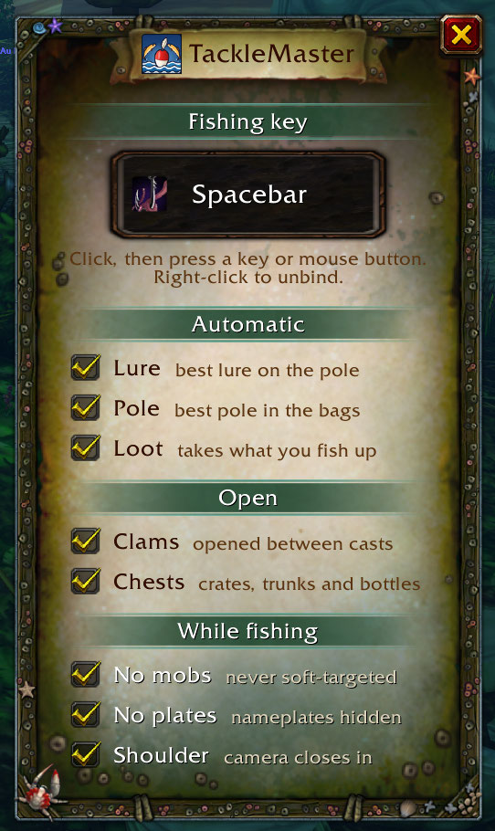
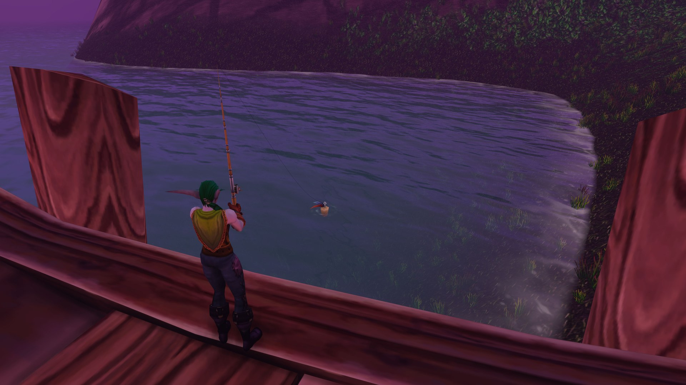

# TackleMaster

One key to fish, for WoW Forever.

Wake it up and your fishing key does the next step every press:

1. equips the best fishing pole in your bags (optional),
2. puts your best lure on it when it has none (optional),
3. opens the clams and chests you fished up (optional),
4. casts,
5. reels in, wherever the mouse is (never a mob under it), and takes the loot (optional).

Send it to sleep and your weapons come back, and the key does its usual thing again. The key is TackleMaster's own, set in its options, so it never clashes with your key bindings. It also lets go of the key in combat, on a mount and when dead.

## Use

- Left-click the fishing button to wake or sleep. Awake, it is lit and shows the key; asleep, it greys out and dozes.
- Right-click it, or `/tm options`, for the options. Drag them anywhere; Escape closes them.
- **Fishing key**: click, then press the key (or mouse button) to fish with. Right-click it to unbind.
- **Automatic**: **Lure**, **Pole** and **Loot** turn each automatic step on or off.
- **Open**: **Clams** and **Chests** open what you fished up, between casts. Locked chests are left alone.
- **While fishing**: **No mobs** stops mobs and NPCs being soft-targeted, **No plates** hides nameplates, both only while awake; **Shoulder** zooms the camera in over your shoulder while the line is out. Sleeping, a fight or a reload puts your settings back as they were.
- Drag the button to move it. `/tm` shows or hides it; `/tm wake`, `/tm sleep`, `/tm toggle`.

## Over the shoulder

With **Shoulder** on, the camera comes in close behind you as the line goes out, the way DialogueUI frames a talk: your angler on one side, the water and the bobber filling the rest. Nothing else to watch, just the float. It eases back out a moment after the catch, so casting again keeps the view. Zoom yourself and it lets go at once.

Pole, lure and container lists come from the game's own data, so it works in every client language.
