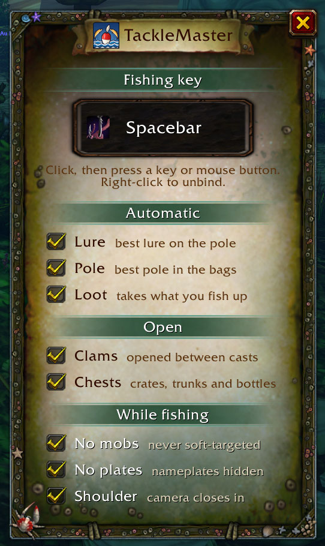
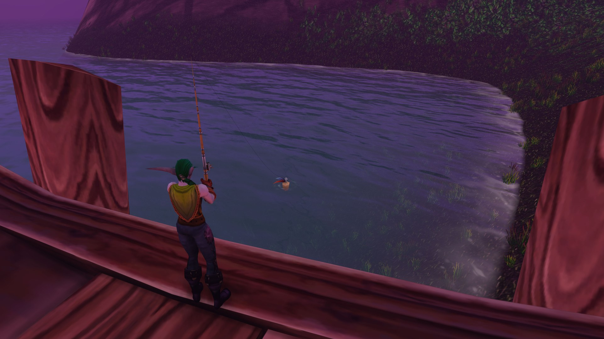

# TackleMaster

**One key to fish.**

Wake it up and your fishing key does the next step every press: best pole, lure, cast, reel, loot, open the clams.

## Features

- **One key**: cast, then reel in on the bite. The key is TackleMaster's own, so it never clashes with your bindings.
- **Wake and sleep**: one button. Asleep, the key does its usual thing again.
- **Best pole**: equips the best fishing pole in your bags and puts your weapons back when you sleep.
- **Lures**: puts your best lure on the pole when it has none.
- **Auto loot**: takes the catch as it lands.
- **Opens the sea's gifts**: clams, crates, trunks and bottles you fished up, between casts. Locked chests are left alone.
- **No stray targets**: the reel only hits the bobber, never a mob under the mouse. Optionally no mob soft-targeting and no nameplates while awake.
- **Over the shoulder**: the camera comes in close behind you while the line is out. Zoom yourself and it lets go.
- **Hook over the bobber**: easy to spot in rough water.
- **Safe**: lets go of the key in combat, on a mount and when dead. Sleeping, a fight or a reload puts every setting back.
- **Every client language**: poles, lures and containers come from the game's own data.

## Setup

Right-click the fishing button (or `/tm options`), click the key box and press the key to fish with. Left-click the button to wake it.

## Commands

| Command | |
| --- | --- |
| `/tm` | show or hide the button |
| `/tm options` | options |
| `/tm wake`, `/tm sleep`, `/tm toggle` | wake or sleep |

## Bugs and ideas

[GitHub issues](https://github.com/f4nu/tackle-master/issues)
